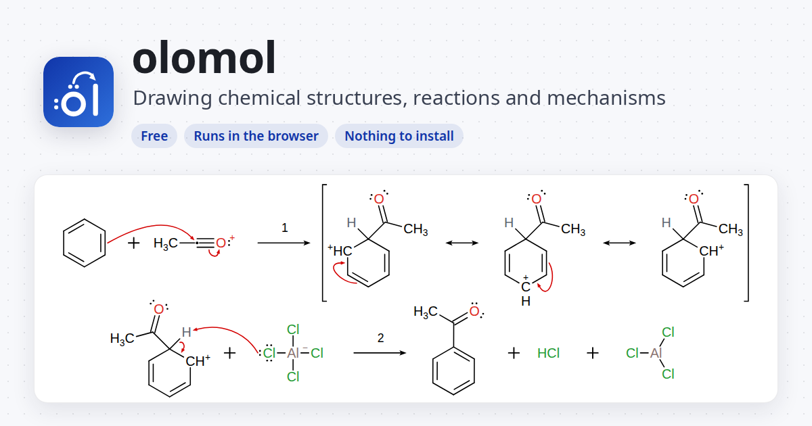
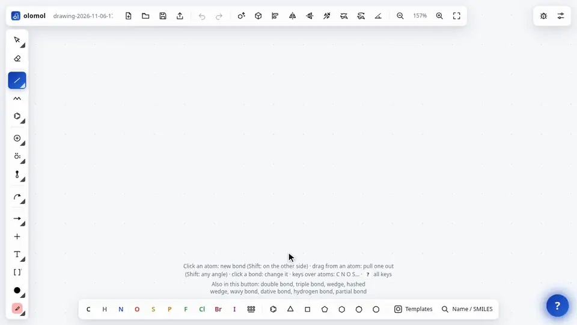
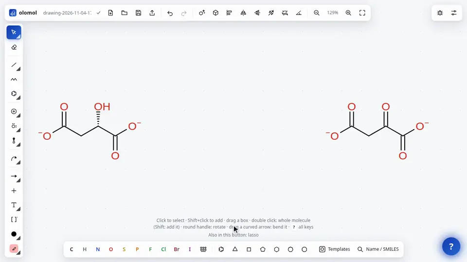
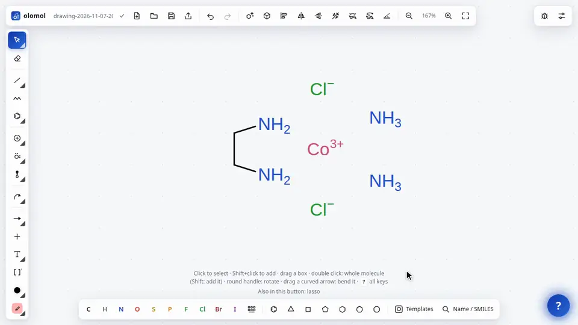
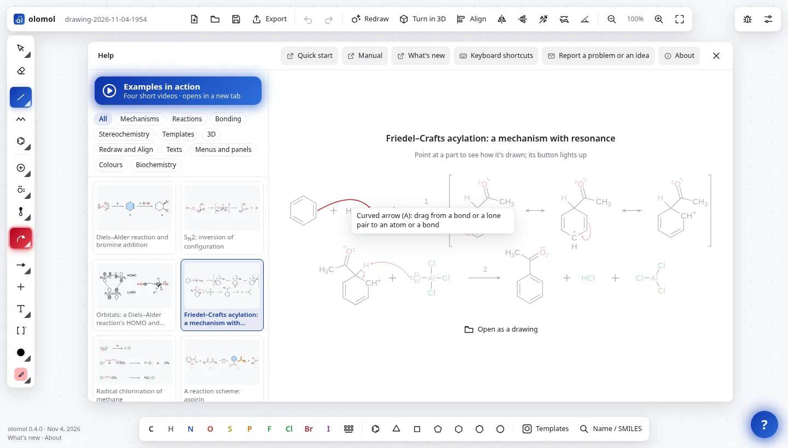

<p align="center">
  <a href="https://olomol.org/"></a>
</p>

<p align="center">
  <a href="https://olomol.org/"><b>Open olomol</b></a> ·
  <a href="https://olomol.org/about.html">About</a> ·
  <a href="https://olomol.org/changelog.html">What's new</a> ·
  Quick start <a href="docs/en/quick-start.pdf">EN</a> / <a href="docs/rychly-start.pdf">CZ</a> ·
  Manual <a href="https://olomol.org/manual.html">EN</a> / <a href="https://olomol.org/cs/manual.html">CZ</a>
  (PDF <a href="docs/en/manual.pdf">EN</a> / <a href="docs/manual.pdf">CZ</a>)
  <br>
  <a href="#citing-olomol">How to cite</a> (DOI <a href="https://doi.org/10.5281/zenodo.24104909">10.5281/zenodo.24104909</a>) ·
  <a href="#building-and-testing">Build it yourself</a>
</p>

**olomol** is a free program for drawing chemical structures, reactions and
curved-arrow mechanisms, made for chemistry education and for anyone who
draws chemistry: lectures and slides,
handouts, exercises, exams, theses and lab reports. It runs entirely in the
web browser: nothing to install, no account, and it speaks Czech, English
and German.

It is made at the Department of Physical Chemistry, Palacký University
Olomouc, Czech Republic. It began as a replacement for ACD/ChemSketch
Freeware in an undergraduate course on graphical skills.

## Try it

Open **[olomol.org](https://olomol.org/)** and start
drawing, or press the round **?** at the bottom right for example drawings
that show how each part was made.

- **Your drawings stay with you.** olomol is a static website with no
  server behind it: drawings live in your browser and in the files you
  save. Only a name or a molecule you look up on PubChem yourself is sent
  there.
- **Works offline.** Once opened, it works without internet, and Chrome or
  Edge can install it as an app.
- **Plays well with others.** Drawings are saved as `.olom` files, an open
  JSON format ([docs/olom.md](docs/olom.md)); pictures as SVG (for
  Inkscape), PNG and PDF, or straight into Word and PowerPoint with
  Ctrl+Shift+C; structures as molfile, SDF, SMILES, InChI, XYZ and KET
  (Ketcher).
- **Your own copy.** Each version is archived on
  [Zenodo](https://doi.org/10.5281/zenodo.24104909) as a zip of the whole
  website, for a department server or your own computer (it needs a web
  server, `python3 -m http.server` will do; `HOW-TO-RUN.txt` in the zip
  says how). [docs/hosting.md](docs/hosting.md) has other ways, with a
  password too.

## What it's good at

**Mechanisms.** Lone pairs, radicals and curved arrows that belong to the
atoms and bonds they start and end at: move a molecule and the arrows find
their way again. An arrow dropped between two atoms forms the new bond, so
radicals combine as in textbooks, and orbitals with their phases and overlap
lines give frontier-orbital pictures. Here an E2 elimination, from an empty
canvas:

<p align="center"></p>

**Reaction schemes.** Reaction, equilibrium and retrosynthesis arrows with
reagents above and below, side arcs for what goes in and comes out
(NAD⁺ → NADH), and one click to line it all up:

<p align="center"></p>

**Building and tidying.** Templates, functional groups that attach where you
click, and Redraw, which offers several clean drawings of a molecule, or of
just the part you select, with R/S and E/Z kept. Here cocaine is built from
tropane turned to the textbook view, a methyl ester and benzoic acid, and then
only the benzoyl part is redrawn:

<p align="center"></p>

**Turn in 3D.** Turn a molecule or a complex with the mouse and get it drawn
as you see it, with wedges that keep its stereochemistry and each ligand in
its place (a metal complex is worked out by a force field). Here a cobalt(III)
complex becomes an octahedron:

<p align="center"></p>

**Conformations.** Chairs that know their stereochemistry, from a template
or drawn by hand. A flat ring or a Haworth projection becomes a chair with
one click, each group axial or equatorial as its wedge says, and the ring flip
turns it into the other chair. Newman projections are real molecules, so an E2
is drawn with curved arrows right in the projection, and Turn in 3D shows the
real shape as a stick model. A molecule drawn with wedges becomes its Fischer
projection with a click, any chain a zigzag, and a Fischer projection drawn by
hand is read as one when you click it; each R/S is kept.

**3D models on the canvas.** Put a molecule's ball-and-stick, stick or
space-filling model beside it in the drawing, turn it from the panel, and
build it again with Update when the molecule changes.

And besides:

- **Templates:** rings, functional groups, chairs, Newman, Fischer and
  Haworth projections, amino acids, sugars, complexes, reagents and
  solvents; search by name, or by part (`?ester`).
- **Structures from names:** type a name, a SMILES or an InChI and place
  the molecule (names are looked up on PubChem).
- **Chemistry it knows:** formula and masses, R/S and E/Z, IUPAC numbering,
  hydrogens and lone pairs filled in. Every redrawing, flip and 3D view is
  checked by RDKit, so the molecule never changes behind your back, and an
  edit that changes it gets a warning.
- **Abbreviations** (Ph, Boc, OMe, PPh₃) that can be drawn out and
  abbreviated again, isotopes, texts with formulas, colours and highlights.
- **For the lesson:** several drawings in tabs, say an exercise and its
  solution, and Show puts them full screen one after another (→ and ←, or
  a clicker). A link such as `olomol.org/#smiles=CCO` or
  `olomol.org/#name=caffeine` opens the structure drawn.
- **Styles** for journals (ACS, RSC) and slides, or your own: bond length,
  lines, label size and font.
- **In your own page:** `embed.html` gives olomol with only the tools
  students should have (curved arrows only, say), and `<olomol-editor>` lets
  the page read what they drew: the curved arrows by their atoms, SMILES,
  InChI, and a step written the same way however it is drawn. Export →
  Embed in a page… writes the code ([docs/embed.md](docs/embed.md)).

The full list is in [docs/features.md](docs/features.md).

<p align="center">
  
  <br><sub>The Help window: example drawings by topic. Point at any part to see how it was made.</sub>
</p>

## Questions, problems, ideas

Use the bug button at the top right of the app: it writes the email for you,
with your browser and the app's version filled in, to
[bugs@olomol.org](mailto:bugs@olomol.org?subject=olomol). Ideas, questions,
translations and everything else go to
[contact@olomol.org](mailto:contact@olomol.org?subject=olomol). The
[manual](https://olomol.org/manual.html) ([Czech](https://olomol.org/cs/manual.html);
PDF: [English](docs/en/manual.pdf), [Czech](docs/manual.pdf)) explains every
tool, and [What's new](https://olomol.org/changelog.html) lists the
changes of each version.

## For developers

### Building and testing

Needs Node.js 24 (the exact version is in `.nvmrc`).

```sh
git clone https://github.com/jan-salomon/olomol.git && cd olomol
npm ci            # install the exact dependency versions from package-lock.json
npm run dev       # development server at http://localhost:5173/
npm run build     # build the static site into dist/
npm run preview   # serve dist/ at http://localhost:4173/
npm test          # unit tests (chemistry against RDKit, file round trips)
npm run check:formats   # every structure export read back by RDKit, Indigo and olomol, against what was drawn
npm run fuzz:files -- --count 50   # generated drawings through every file format; each kind of failure shrunk into test-output/fuzz/
npm run check     # the browser check, on a running dev server (npm run dev), in headless Chrome
npm run check -- --only drawing,files   # only some topics (scripts/check/)
npm run check -- --jobs 3               # three topics at a time
npm run check -- --copy --jobs 3        # on a copy of the checkout, served on its own: files saved meanwhile change nothing
node scripts/arrow-gallery.mjs   # textbook mechanisms in one picture (test-output/)
```

More in [docs/README.md](docs/README.md) (how the manuals and the clips
above are made), [docs/hosting.md](docs/hosting.md) (putting it on a web
server) and [docs/olom.md](docs/olom.md) (the `.olom` file format, for
programs that read or write olomol's drawings).

### Where things are

| Folder | What |
|---|---|
| `src/model/` | the drawing as data (`doc.js`: atoms, bonds, arrows, text, curved arrows) and the molecule graph (`graph.js`: molecules, rings) |
| `src/chem/` | element data, hydrogens and lone pairs (`valence.js`), formula and mass, R/S labels, templates and chairs, Fischer projections and zigzags (`fischer.js`, `chains.js`), delocalized groups (`delocalize.js`) |
| `src/render/` | from the data to a picture: labels, bonds, electrons and curved arrows (`mechanism.js`, the arrow rules), 3D models (`model3d.js`, `sticks.js`), SVG |
| `src/editor/` | the editor (selection, undo, view), the tools, hit testing, building rings and chains |
| `src/arrange/` | Align and Align reaction |
| `src/layout/` | Redraw and Turn in 3D: the engines, ring templates, 3D models, the SMILES check |
| `src/io/` | files: .olom (`olom.js`), KET, molfile, RDKit and Indigo (in a background thread), links, the PubChem lookup |
| `src/ui/` | the screen: canvas, toolbars, panel, menus, dialogs (React) |
| `src/embed/`, `src/features.js` | olomol in another page: the parts switched on or off, the bridge to the page (`postMessage`), the canonical form of a curved-arrow step |
| `src/i18n/` | the languages: `t()` and one table per language (`cs.js`, `de.js`; `en.js` for English singulars: 1 lone pair, 2 lone pairs) |
| `tests/`, `scripts/` | unit tests, the browser check, the file-format checks and fuzzer (`scripts/formats/`), the arrow gallery |
| `bench/` | the benchmarks: what olomol claims, measured against truths from elsewhere, with a report of every case |

## Citing olomol

If olomol helped with a publication, a thesis or teaching materials, please
cite it with the version you used. olomol's About window gives the citation,
to copy as text, BibTeX, RIS or CSL JSON or to save for a reference manager:
olomol's DOI on Zenodo, of all its versions, and the version's number. On
GitHub, *Cite this repository* in the sidebar gives it too, from
[CITATION.cff](CITATION.cff). For version 0.5.0:

> Salomon, J. (2026). *olomol: drawing chemical structures, reactions and mechanisms*
> (Version 0.5.0) [Computer software]. Zenodo.
> [https://doi.org/10.5281/zenodo.24104909](https://doi.org/10.5281/zenodo.24104909)

The DOI leads to the newest version; the record lists every archived version,
each with a DOI of its own (0.5.0: 10.5281/zenodo.24375817).

## Credits and licence

- **RDKit** / RDKit.js (`@rdkit/rdkit`, WebAssembly), BSD 3-Clause License:
  layouts, SMILES, InChI, R/S labels, the check of every redrawing,
  including a copy of RDKit's ring-system templates (© 2023 Schrödinger,
  LLC, part of RDKit) in `src/layout/ringTemplateData.js`, and a morphinan
  template derived from one of them in `src/layout/extraTemplates.js`; the
  universal force field (UFF) for metal complexes is ported from RDKit's
  (`src/layout/uff.js`, `uffParams.js`).
- **megane-rdkit** (WebAssembly build of RDKit by hodakamori), BSD 3-Clause
  License: 3D conformers (ETKDG) and MMFF94s.
- **OpenChemLib** (`openchemlib`) by Actelion and Idorsia, BSD 3-Clause
  License: 3D structures where RDKit has none, MMFF94s+ energies, ligand
  shapes for metal complexes.
- **Indigo** (`indigo-ketcher`, WebAssembly) by EPAM Systems, Apache License
  2.0: file formats (RXN, CDXML, CDX, SDF, CML) and its layout engine, used
  as a library, unmodified.
- The KET file format is that of **Ketcher** (EPAM Systems, Apache 2.0), so
  drawings move between the two. No Ketcher code is copied into this
  repository.
- **React** (MIT) for the panels and menus.
- **PubChem** (US National Library of Medicine) answers name and number
  lookups when asked; nothing of it is bundled.

License texts and notices are in
[`public/THIRD_PARTY_LICENSES/`](public/THIRD_PARTY_LICENSES/), which is also
published with the site. olomol's own code is under the
[MIT License](LICENSE).

## AI disclosure

The code in this repository was written with substantial help from Claude,
an AI model by Anthropic.
